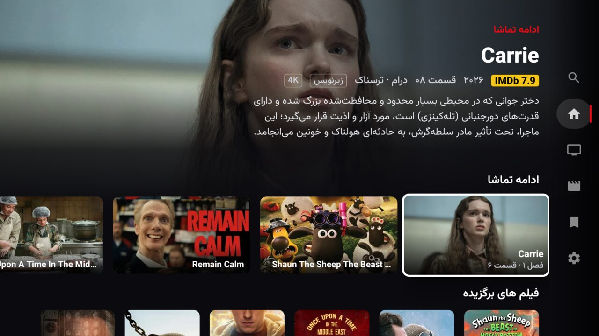
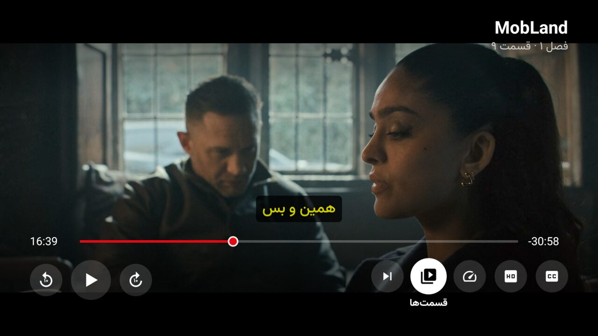
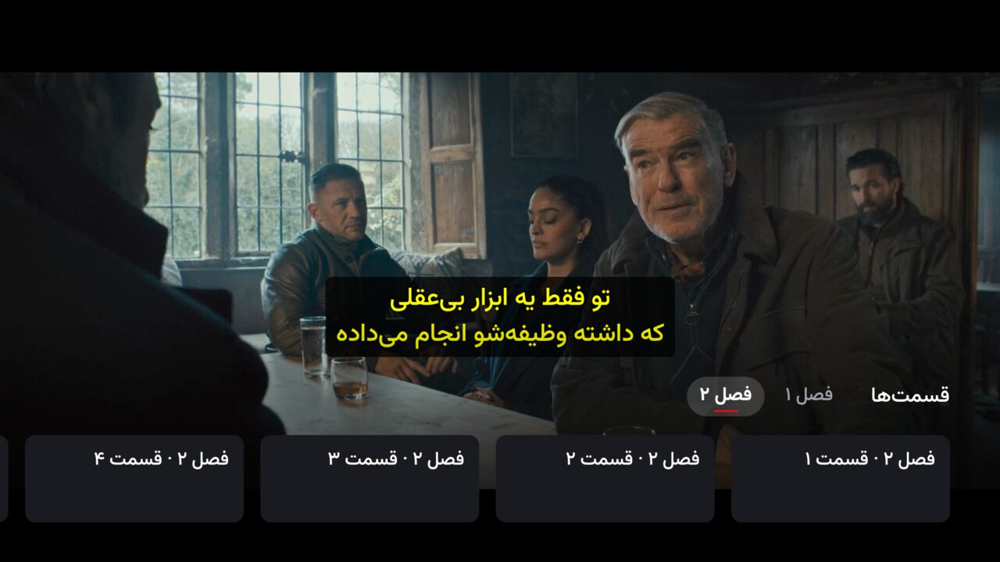
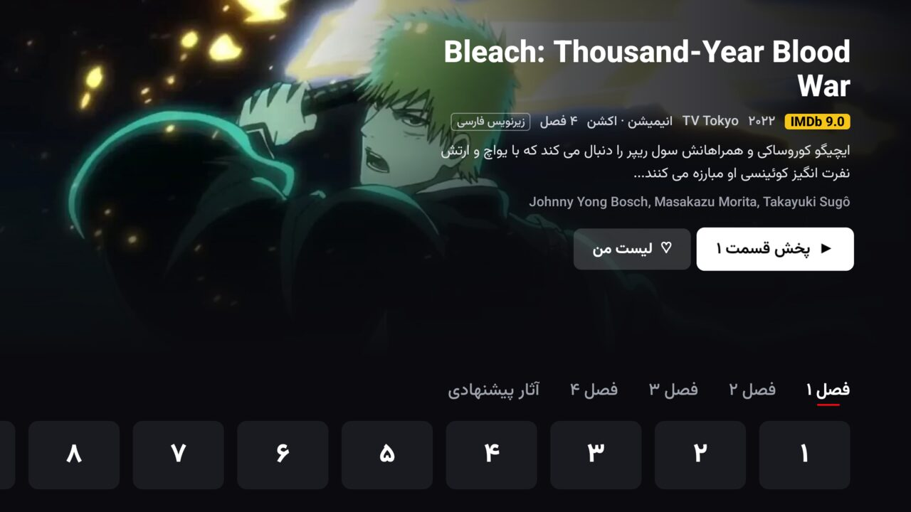
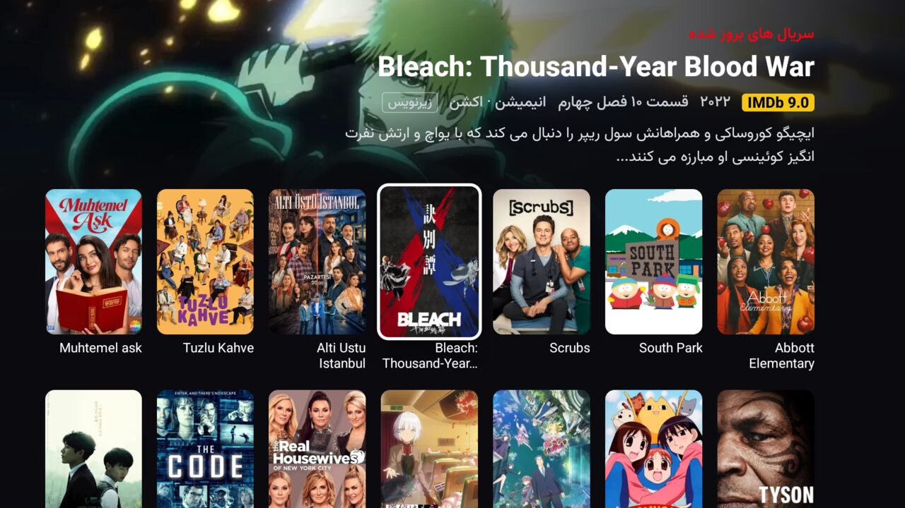
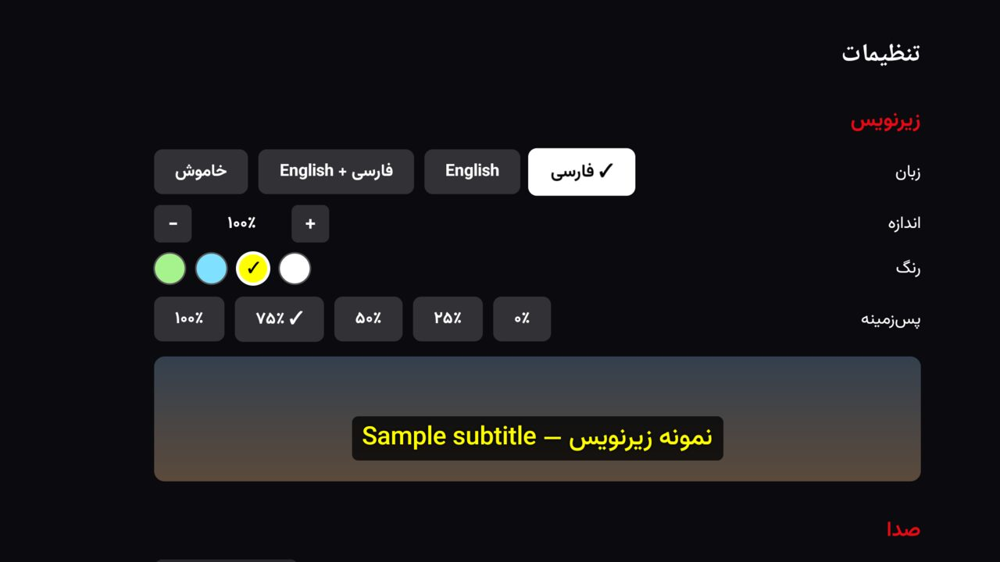

<div align="center">

# DRooz for Android TV

**Your DLRooz movies and series, made for the big screen.**

A fast, good-looking TV app for [DLRooz](https://robin.robert-redford.net/): browse with the remote, pick up where you left off, and watch with Persian subtitles that look great.

[**⬇ Download the latest APK**](https://github.com/AliKarami/DRooz-AndroidTV/releases/latest/download/DRooz.apk) · [All releases](https://github.com/AliKarami/DRooz-AndroidTV/releases) · [راهنمای فارسی](#راهنمای-فارسی)



</div>

## Why you'll like it

- **Feels like a real streaming app.** Big artwork, a hero banner that follows what you're looking at, and smooth remote navigation. It's not a website squeezed onto a TV.
- **One press to keep watching.** «ادامه تماشا» knows the next episode and where you stopped. Press OK and it plays.
- **Subtitles done right.** Farsi, English, or **both at once**. Pick the size, colour and background, and fix out-of-sync subtitles in half-second steps.
- **Everything the site's player has.** Quality picker, 5.1 surround sound, Persian dub, Audio Boost for quiet dialogue, playback speed, and next-episode autoplay.
- **Persian first.** Menus are fully right-to-left in Persian; titles keep their original names.

<table>
  <tr>
    <td></td>
    <td></td>
  </tr>
  <tr>
    <td align="center">Simple player controls</td>
    <td align="center">Jump to any season or episode without leaving the player</td>
  </tr>
  <tr>
    <td></td>
    <td></td>
  </tr>
  <tr>
    <td align="center">Series pages with every season</td>
    <td align="center">Browse new and updated titles</td>
  </tr>
  <tr>
    <td colspan="2" align="center"><br>Subtitle style with a live preview</td>
  </tr>
</table>

## What you need

- A TV, TV box or stick running **Android TV or Google TV** (Android 12 or newer).
- A **DLRooz account**. You sign in once with your usual username and password.

## Install in 3 minutes

The app isn't on the Play Store, so you install it from the file here. It's easy:

1. **Get the Downloader app.** On your TV, open the **Play Store**, search for **Downloader** (the orange app by AFTVnews) and install it.
2. **Allow it to install apps.** Open **Settings → Apps → Security & restrictions → Unknown sources** (on some TVs: **Settings → Privacy → Security → Install unknown apps**) and turn on **Downloader**.
3. **Download and install DRooz.** Open Downloader, type this address and press **Go**:

   ```
   github.com/AliKarami/DRooz-AndroidTV/releases/latest/download/DRooz.apk
   ```

   When the download finishes, choose **Install**. Then **Open**, sign in, and enjoy.

You'll find **DRooz** with your other apps. Downloader can delete the APK file afterwards, since you don't need it any more.

**Updating:** repeat step 3 whenever there's a new release. Your login and settings are kept.

<details>
<summary>Other ways to install</summary>

- **From your phone:** download [DRooz.apk](https://github.com/AliKarami/DRooz-AndroidTV/releases/latest/download/DRooz.apk) on your phone and send it to the TV with an app like *Send Files to TV*, then open it on the TV.
- **From a computer (adb):** turn on *Developer options → USB debugging* on the TV, then run
  `adb connect <TV-IP>` and `adb install -r DRooz.apk`.

</details>

## Good to know

- DRooz is an **unofficial** app made by a fan. It's not affiliated with DLRooz. You need your own DLRooz subscription, and the app only uses what your account already gives you.
- Your password is stored encrypted on your TV and is only ever sent to the DLRooz site.
- DLRooz allows a limited number of devices per account; your TV counts as one.

Found a bug or have an idea? [Open an issue](https://github.com/AliKarami/DRooz-AndroidTV/issues).

---

## راهنمای فارسی

<div dir="rtl">

**دی‌ال‌روز برای تلویزیون**: فیلم‌ها و سریال‌های دی‌ال‌روز روی تلویزیون، با منوی فارسی، «ادامه تماشا» با یک دکمه، و زیرنویس فارسی و انگلیسی (حتی هر دو با هم).

**نصب:**

۱. در **Play Store** تلویزیون، برنامه‌ی **Downloader** را نصب کنید.<br>
۲. در تنظیمات تلویزیون، اجازه‌ی **نصب برنامه از منابع ناشناس** را به Downloader بدهید.<br>
۳. Downloader را باز کنید، این آدرس را وارد کنید و **Install** را بزنید:

</div>

```
github.com/AliKarami/DRooz-AndroidTV/releases/latest/download/DRooz.apk
```

<div dir="rtl">

بعد از نصب، با نام کاربری و رمز دی‌ال‌روز خودتان وارد شوید. نیازمندی‌ها: Android TV یا Google TV با اندروید ۱۲ یا بالاتر، و حساب دی‌ال‌روز.

</div>

---

<details>
<summary>For developers</summary>

Kotlin, Jetpack Compose for TV and Media3 ExoPlayer. Build with JDK 17+ and the Android SDK:

```bash
./gradlew testDebugUnitTest   # unit tests (site parsers run against sanitized saved pages)
./gradlew assembleDebug
```

Release APKs are signed with a private key that isn't in this repository, so an APK you build yourself can't update one installed from Releases. Never commit cookies, tokens, credentials or captured stream URLs; `scripts/sanitize_fixture.py` cleans captured pages before they become test fixtures. Design notes and plans live in [`docs/superpowers`](docs/superpowers).

</details>
